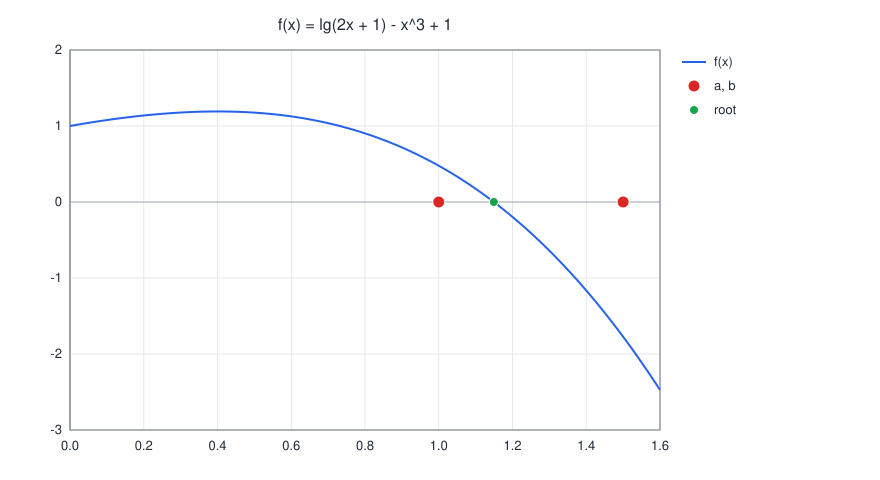
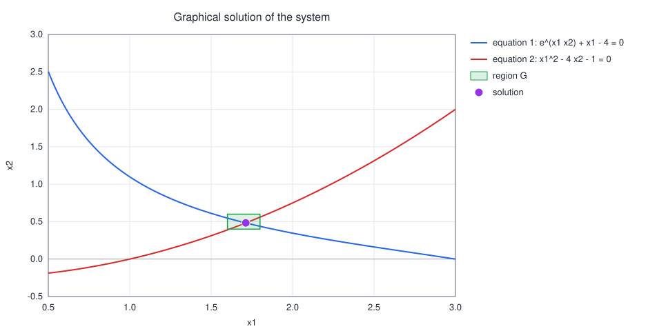

# Lab 2. Numerical Methods for Nonlinear Equations

## Task

Variant 28. Every task lives in its own folder:

| No. | Folder | Method | Result |
| --- | --- | --- | --- |
| 2.1 | [task1](task1/) | simple iteration and Newton methods | positive root of a nonlinear equation, error depending on the iteration |
| 2.2 | [task2](task2/) | simple iteration and Newton methods for systems | positive solution of a nonlinear system, error depending on the iteration |

## Build and run

```bash
make run LAB=lab2
make run LAB=lab2 TASK=task1
make run LAB=lab2 TASK=task1 ARGS=my_input.txt
make test LAB=lab2
```

The first command runs both tasks, the second one task on its `input.txt`, the third one task on another file. Without `make`: `python3 -m lab2.main` and `python3 -m lab2.task1.main [file]` from the repository root. Every run also saves the graph `plot.svg` next to the input file.

## Example

2.1, $\varepsilon = 10^{-6}$:

$$
\lg(2x + 1) - x^3 + 1 = 0, \qquad x \in [1, 1.5], \qquad x \approx 1.149362
$$

The graph localizes the positive root on $[1, 1.5]$. Simple iteration uses $x = \varphi(x) = \sqrt[3]{1 + \lg(2x + 1)}$ with $q = \max |\varphi'(x)| \approx 0.0744$ and stops when $\frac{q}{1 - q} |x_k - x_{k-1}| \le \varepsilon$. Newton's method starts at the end of the interval where $f(x_0) f''(x_0) > 0$ and stops when $|x_k - x_{k-1}| \le \varepsilon$.



2.2, $a = 4$, $\varepsilon = 10^{-6}$:

$$
\begin{cases}
e^{x_1 x_2} + x_1 - a = 0 \\
x_1^2 - a x_2 - 1 = 0
\end{cases}
\qquad G = [1.6, 1.8] \times [0.4, 0.6], \qquad x \approx (1.712517, 0.483179)
$$

Simple iteration uses $\varphi(x) = x - J^{-1}(x^{(0)}) f(x)$, where $x^{(0)}$ is the center of $G$ and $q = \max_G \lVert \varphi'(x) \rVert_\infty \approx 0.3817$. Newton's method solves $J(x^{(k)}) \Delta x = -f(x^{(k)})$ with the LU decomposition from lab 1.



## Notes

Input: numbers or expressions without spaces (`pi/6`, `e^2`) separated by spaces or new lines.

| Task | Input |
| --- | --- |
| task1 | interval $a$, $b$, precision $\varepsilon$ |
| task2 | parameter $a$, region $G$: range of $x_1$, range of $x_2$, precision $\varepsilon$ |

Both programs check the convergence conditions on the given interval or region. Invalid input or a failed method prints `error: <message>` to stderr and exits with code 1.

Layout:

```text
lab2/
  README.md
  main.py        runs both tasks
  common.py      precision helpers shared by the tasks
  task1/
    main.py      the variant: reads input.txt (or the given file), prints the result, saves plot.svg
    equation.py  the methods
    input.txt    data of the variant
    output.txt   expected output, checked by the tests
    plot.svg     graph of the variant, checked by the tests
  task2/         the same layout, the methods are in system.py
  tests/         tests of every method and of all programs
```

Input reading, formatting and graphs come from [lab1/common.py](../lab1/common.py).
