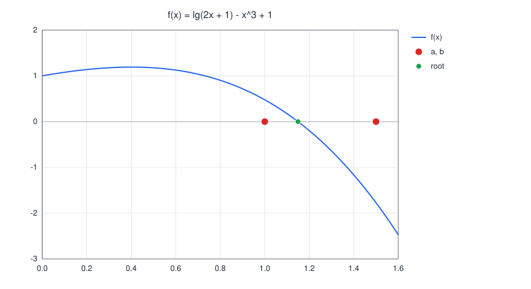

# 2.1. Simple Iteration and Newton Methods for an Equation

Finds the positive root of a nonlinear equation with a given precision and compares the linear and quadratic convergence of the two methods.

## Task

Implement the simple iteration method and Newton's method for nonlinear equations, taking the precision as input. Use them to find the positive root of the nonlinear equation; find the initial approximation graphically. Analyse how the error depends on the number of iterations.

Variant 28:

$$
f(x) = \lg(2x + 1) - x^3 + 1 = 0, \qquad \varepsilon = 10^{-6}
$$

Answer: $x \approx 1.149362$.

## Method

- **Localization.** The graph shows a single positive root near $1.15$. On $[1, 1.5]$ the function changes sign, $f(1) = 0.477$, $f(1.5) = -1.773$, and decreases monotonically, so the root there is unique.
- **Simple iteration.** The equation is rewritten as $x = \varphi(x) = \sqrt[3]{1 + \lg(2x + 1)}$ and $x_{k+1} = \varphi(x_k)$, $x_0 = (a + b) / 2$. The method converges when $\varphi$ maps $[a, b]$ into itself and $q = \max_{[a, b]} |\varphi'(x)| < 1$; here $q = 0.0744$. It stops when $\frac{q}{1 - q}|x_k - x_{k-1}| \le \varepsilon$.
- **Newton's method.** $x_{k+1} = x_k - \frac{f(x_k)}{f'(x_k)}$ is the intersection of the tangent with the $x$ axis. The start is the end of the interval where $f(x_0)f''(x_0) > 0$, here $x_0 = 1.5$, so the iterations approach the root from one side. It stops when $|x_k - x_{k-1}| \le \varepsilon$.

Both programs check the convergence conditions on the given interval and report an error when they fail. Simple iteration converges linearly (the error is multiplied by about $q$ at every step), Newton's method quadratically (the number of correct digits doubles).

## Run

```bash
make run LAB=lab2 TASK=task1
make run LAB=lab2 TASK=task1 ARGS=my_input.txt
python3 -m lab2.task1.main [file]
```

Commands run from the repository root. Without an argument the program reads `input.txt` next to `main.py`. Every run also saves the graphs next to the input file.

## Input

Numbers separated by spaces or new lines: the ends $a$, $b$ of the interval with the root and the precision $\varepsilon$.

```text
1 1.5
0.000001
```

## Output

```text
Simple iteration: x = 1.149362, 5 iterations
q = max |phi'(x)| = 0.0744
  k       x_k  q/(1-q)|x_k - x_(k-1)|
  0  1.250000                       -
  1  1.155816              7.5715e-03
  2  1.149790              4.8446e-04
  3  1.149391              3.2108e-05
  4  1.149364              2.1329e-06
  5  1.149362              1.4171e-07

Newton method: x = 1.149362, 5 iterations
  k       x_k  |x_k - x_(k-1)|
  0  1.500000                -
  1  1.228612       2.7139e-01
  2  1.154768       7.3844e-02
  3  1.149390       5.3782e-03
  4  1.149362       2.7661e-05
  5  1.149362       7.2962e-10

Iterations depending on the precision:
    eps  simple  Newton
  1e-01       1       2
  1e-02       1       3
  1e-03       2       4
  1e-04       3       4
  1e-05       4       5
  1e-06       5       5
  1e-07       6       5
  1e-08       6       5
  1e-09       7       5
  1e-10       8       6
```

For each method: the root, the number of iterations and a table of iterations with the error estimate; then the number of iterations for $\varepsilon = 10^{-1}, \ldots, 10^{-10}$.

## Analysis

| $\varepsilon$ | $10^{-2}$ | $10^{-4}$ | $10^{-6}$ | $10^{-8}$ | $10^{-10}$ |
| --- | --- | --- | --- | --- | --- |
| simple iteration | 1 | 3 | 5 | 6 | 8 |
| Newton | 3 | 4 | 5 | 5 | 6 |

- **Simple iteration** converges linearly: the error is multiplied by at most $q = 0.0744$ at every step, which gives a little more than one decimal digit per iteration.
- **Newton's method** converges quadratically: the steps $0.27 \to 0.074 \to 5.4 \cdot 10^{-3} \to 2.8 \cdot 10^{-5} \to 7.3 \cdot 10^{-10}$ show the number of correct digits doubling.
- For a low precision simple iteration is even faster: $q$ is very small, it starts from the middle of the interval, while Newton starts from its end. For a high precision the quadratic convergence wins.

## Graphs

`plot.svg`: the graph of $f(x)$ with the root localization interval $[a, b]$ highlighted and the root found.



## Files

| File | Contents |
| --- | --- |
| [main.py](main.py) | the variant: reads the input, prints the result, saves the graphs |
| [equation.py](equation.py) | both methods and the contraction factor $q$ |
| [input.txt](input.txt) | data of the variant |
| [output.txt](output.txt) | expected output, checked by the tests |
| [plot.svg](plot.svg) | graph of the variant, checked by the tests |

Invalid input or a failed method prints `error: <message>` to stderr and exits with code 1.
