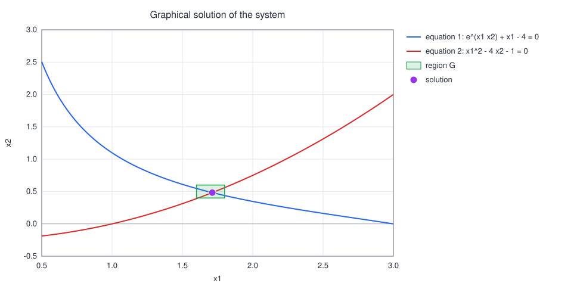
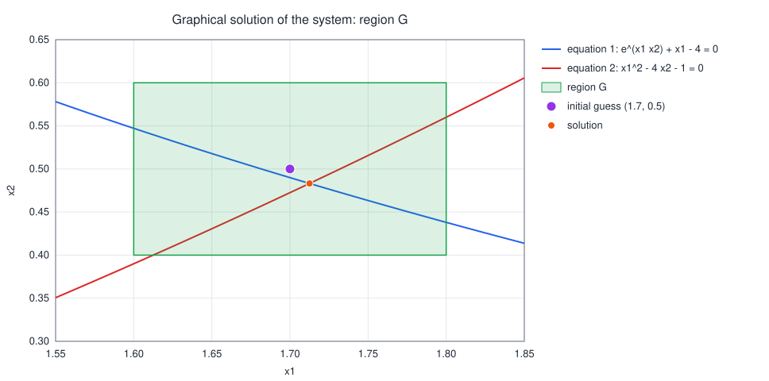

# 2.2. Simple Iteration and Newton Methods for a System

Finds the positive solution of a system of two nonlinear equations with a given precision; the initial approximation comes from the graph.

## Task

Implement the simple iteration method and Newton's method for systems of nonlinear equations, taking the precision as input. Use them to solve the system of nonlinear equations (if there are several solutions, find the one with positive unknowns); find the initial approximation graphically. Analyse how the error depends on the number of iterations.

Variant 28:

$$
\begin{cases}
e^{x_1 x_2} + x_1 - a = 0 \\
x_1^2 - a x_2 - 1 = 0
\end{cases}
\qquad a = 4, \qquad \varepsilon = 10^{-6}
$$

Answer: $x \approx (1.712517, 0.483179)$.

## Method

- **Localization.** Each equation is a curve in the plane: $x_2 = \ln(a - x_1) / x_1$ and $x_2 = (x_1^2 - 1) / a$. The first decreases, the second increases, so they intersect once, near $(1.7, 0.5)$. The region $G = [1.6, 1.8] \times [0.4, 0.6]$ around it is given in the input, its center is the initial approximation $x^{(0)}$.
- **Newton's method.** $J(x^{(k)})\,\Delta x^{(k)} = -F(x^{(k)})$, $x^{(k+1)} = x^{(k)} + \Delta x^{(k)}$, where $J$ is the Jacobian matrix
  $$J(x) = \begin{pmatrix} x_2 e^{x_1 x_2} + 1 & x_1 e^{x_1 x_2} \\ 2x_1 & -a \end{pmatrix}.$$
  The linear system is solved with the LU decomposition from lab 1. The method stops when $\lVert \Delta x^{(k)} \rVert_\infty \le \varepsilon$.
- **Simple iteration.** Solving the equations for $x_1$ and $x_2$ directly gives $\lVert \varphi' \rVert > 1$ here (1.17 and 5.02 for the two natural choices), so the method uses $\varphi(x) = x - \Lambda F(x)$ with $\Lambda = J^{-1}(x^{(0)})$. Its fixed points are the solutions of $F(x) = 0$, and $\varphi'(x) = E - \Lambda J(x)$ vanishes at $x^{(0)}$. The program computes $q = \max_G \lVert \varphi'(x) \rVert_\infty = 0.3817$ on a $41 \times 41$ grid, checks $q < 1$ and $\varphi(G) \subset G$, and stops when $\frac{q}{1 - q}\lVert x^{(k)} - x^{(k-1)} \rVert_\infty \le \varepsilon$.

The first step of both methods is the same, because at $x^{(0)}$ the formula $x - J^{-1}(x^{(0)})F(x)$ is exactly a Newton step. After that Newton's method recomputes $J$ and converges quadratically, simple iteration keeps $\Lambda$ and converges linearly.

## Run

```bash
make run LAB=lab2 TASK=task2
make run LAB=lab2 TASK=task2 ARGS=my_input.txt
python3 -m lab2.task2.main [file]
```

Commands run from the repository root. Without an argument the program reads `input.txt` next to `main.py`. Every run also saves the graphs next to the input file.

## Input

Numbers separated by spaces or new lines: the parameter $a$, the range of $x_1$, the range of $x_2$ (the region $G$) and the precision $\varepsilon$.

```text
4
1.6 1.8
0.4 0.6
0.000001
```

## Output

```text
Simple iteration: x = (1.712517, 0.483179), 3 iterations
q = max ||phi'(x)|| = 0.3817
  k      x1_k      x2_k  q/(1-q)||x_k - x_(k-1)||
  0  1.700000  0.500000                         -
  1  1.712563  0.483178                1.0386e-02
  2  1.712518  0.483179                2.7998e-05
  3  1.712517  0.483179                3.4019e-07

Newton method: x = (1.712517, 0.483179), 3 iterations
  k      x1_k      x2_k  ||x_k - x_(k-1)||
  0  1.700000  0.500000                  -
  1  1.712563  0.483178         1.6822e-02
  2  1.712517  0.483179         4.5667e-05
  3  1.712517  0.483179         4.6382e-10

Iterations depending on the precision:
    eps  simple  Newton
  1e-01       1       1
  1e-02       2       2
  1e-03       2       2
  1e-04       2       2
  1e-05       3       3
  1e-06       3       3
  1e-07       4       3
  1e-08       4       3
  1e-09       5       3
  1e-10       6       4
```

For each method: the solution, the number of iterations and a table of iterations with the error estimate; then the number of iterations for $\varepsilon = 10^{-1}, \ldots, 10^{-10}$.

## Analysis

| $\varepsilon$ | $10^{-2}$ | $10^{-4}$ | $10^{-6}$ | $10^{-8}$ | $10^{-10}$ |
| --- | --- | --- | --- | --- | --- |
| simple iteration | 2 | 2 | 3 | 4 | 6 |
| Newton | 2 | 2 | 3 | 3 | 4 |

- **Newton's method** converges quadratically: $\lVert \Delta x \rVert = 1.7 \cdot 10^{-2} \to 4.6 \cdot 10^{-5} \to 4.6 \cdot 10^{-10}$.
- **Simple iteration** converges linearly, but fast, because $\varphi'$ vanishes at the center of $G$ and stays small near the solution.
- Up to $10^{-6}$ the methods need the same number of iterations; for higher precision Newton's method is faster, while one step of simple iteration is cheaper (no new Jacobian matrix and no linear system).

## Graphs

`plot.svg`: both curves, the region $G$ and the solution at their intersection.



`plot_zoom.svg`: the same graph zoomed to the region $G$: the initial approximation $x^{(0)}$ and the solution.



## Files

| File | Contents |
| --- | --- |
| [main.py](main.py) | the variant: reads the input, prints the result, saves the graphs |
| [system.py](system.py) | both methods, the matrix $\Lambda = J^{-1}(x^{(0)})$ and the contraction factor $q$ |
| [input.txt](input.txt) | data of the variant |
| [output.txt](output.txt) | expected output, checked by the tests |
| [plot.svg](plot.svg) | graph of the variant, checked by the tests |
| [plot_zoom.svg](plot_zoom.svg) | graph of the variant, checked by the tests |

Invalid input or a failed method prints `error: <message>` to stderr and exits with code 1.
