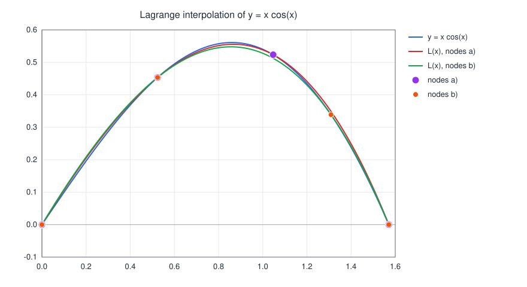
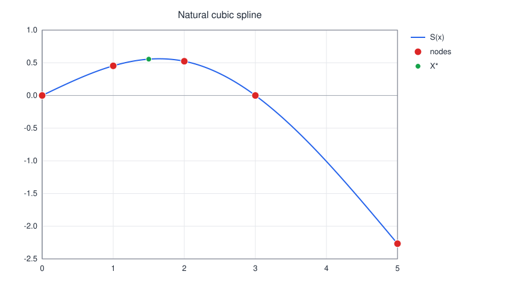
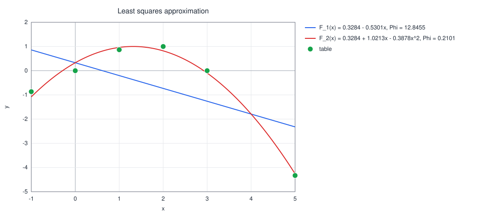

# Lab 3. Approximation, Numerical Differentiation and Integration

## Task

Variant 28. Every task lives in its own folder:

| No. | Folder | Method | Result |
| --- | --- | --- | --- |
| 3.1 | [task1](task1/) | Lagrange and Newton interpolation polynomials | polynomials for two sets of nodes, interpolation error at $X^*$ |
| 3.2 | [task2](task2/) | natural cubic spline | spline coefficients, value at $X^*$ |
| 3.3 | [task3](task3/) | least squares | polynomials of degree 1 and 2, sums of squared errors, graphs |
| 3.4 | [task4](task4/) | numerical differentiation | first and second derivatives at $X^*$ |
| 3.5 | [task5](task5/) | rectangle, trapezoid and Simpson rules | integral for two steps, Runge-Romberg error estimate |

## Build and run

```bash
make run LAB=lab3
make run LAB=lab3 TASK=task2
make run LAB=lab3 TASK=task2 ARGS=my_input.txt
make test LAB=lab3
```

The first command runs all five tasks, the second one task on its `input.txt`, the third one task on another file. Without `make`: `python3 -m lab3.main` and `python3 -m lab3.task2.main [file]` from the repository root. Tasks 3.1-3.3 also save the graph `plot.svg` next to the input file.

## Example

3.1, $y = x \cos x$, $X^* = \pi / 4$:

$$
X_a = \left(0, \tfrac{\pi}{6}, \tfrac{\pi}{3}, \tfrac{\pi}{2}\right): \ \Delta(X^*) \approx 5.77 \cdot 10^{-3},
\qquad
X_b = \left(0, \tfrac{\pi}{6}, \tfrac{5\pi}{12}, \tfrac{\pi}{2}\right): \ \Delta(X^*) \approx 1.20 \cdot 10^{-2}
$$



3.2, zero curvature at both ends, $X^* = 1.5$:

| $x_i$ | 0.0 | 1.0 | 2.0 | 3.0 | 5.0 |
| --- | --- | --- | --- | --- | --- |
| $f_i$ | 0.0 | 0.45345 | 0.52360 | 0.0 | -2.2672 |

$S(1.5) \approx 0.5556$. The system for $c_i$ is tridiagonal and is solved with the Thomas algorithm from lab 1.



3.3:

| $x_i$ | -1.0 | 0.0 | 1.0 | 2.0 | 3.0 | 5.0 |
| --- | --- | --- | --- | --- | --- | --- |
| $y_i$ | -0.86603 | 0.0 | 0.86603 | 1.0 | 0.0 | -4.3301 |

$F_1(x) = 0.3284 - 0.5301x$ with $\Phi = 12.8455$, $F_2(x) = 0.3284 + 1.0213x - 0.3878x^2$ with $\Phi = 0.2101$. The normal systems are solved with the LU decomposition from lab 1.



3.4, $X^* = 0.4$:

| $x_i$ | 0.0 | 0.2 | 0.4 | 0.6 | 0.8 |
| --- | --- | --- | --- | --- | --- |
| $y_i$ | 0.0 | 0.048856 | 0.23869 | 0.65596 | 1.4243 |

$y'(0.4) \approx 0.9492$ (left), $2.0864$ (right), $1.5178$ (second order), $y''(0.4) \approx 5.6859$.

3.5:

$$
F = \int_1^5 x^3 \sqrt{4 + x^2} \, dx \approx 701.2851, \qquad h_1 = 1, \quad h_2 = 0.5
$$

Runge-Romberg: $F \approx F_{h_2} + \dfrac{F_{h_2} - F_{h_1}}{k^p - 1}$, $k = h_1 / h_2$, $p = 2$ for rectangles and trapezoids, $p = 4$ for Simpson. The exact value comes from the antiderivative and shows the real errors next to the estimates.

## Notes

Input: numbers or expressions without spaces (`pi/6`, `5*pi/12`, `e^2`) separated by spaces or new lines. A table is its size $n$, then $n$ nodes and $n$ values.

| Task | Input |
| --- | --- |
| task1 | number of nodes $n$, nodes of set a), nodes of set b), point $X^*$ |
| task2 | table, point $X^*$ |
| task3 | table |
| task4 | table, point $X^*$ |
| task5 | limits $X_0$, $X_k$, steps $h_1$, $h_2$ |

Invalid input or a failed method prints `error: <message>` to stderr and exits with code 1.

Layout:

```text
lab3/
  README.md
  main.py              runs all five tasks
  common.py            polynomial helpers and table reading
  task1/
    main.py            the variant: reads input.txt (or the given file), prints the result, saves plot.svg
    interpolation.py   the methods
    input.txt          data of the variant
    output.txt         expected output, checked by the tests
    plot.svg           graph of the variant, checked by the tests
  task2/ ... task5/    the same layout: spline.py, least_squares.py, derivative.py, integration.py
  tests/               tests of every method, of common.py and of all programs
```
