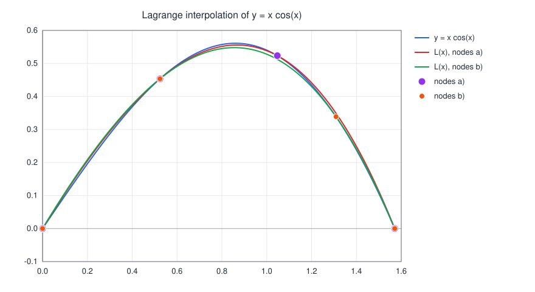

# 3.1. Lagrange and Newton Interpolation

[Lab 3](../README.md) / 3.1

Builds the interpolation polynomial through four points in two forms and measures its error between the nodes.

## Task

Using the values $Y_i$ of the function $y = f(x)$ at the points $X_i$, $i = 0, \ldots, 3$, build the Lagrange and Newton interpolation polynomials passing through the points $\{X_i, Y_i\}$. Compute the interpolation error at the point $X^*$.

Variant 28:

$$
y = x \cos x, \qquad
\text{a) } X_i = 0, \tfrac{\pi}{6}, \tfrac{2\pi}{6}, \tfrac{3\pi}{6}; \qquad
\text{b) } X_i = 0, \tfrac{\pi}{6}, \tfrac{5\pi}{12}, \tfrac{\pi}{2}; \qquad
X^* = \tfrac{\pi}{4}
$$

Answer: the error at $X^*$ is $5.77 \cdot 10^{-3}$ for a) and $1.20 \cdot 10^{-2}$ for b).

## Method

Through $n + 1$ points passes exactly one polynomial of degree $n$; the two methods are two ways to write it.

- **Lagrange.** $L(x) = \sum_i \frac{y_i}{\omega'(x_i)} \prod_{j \ne i}(x - x_j)$, where $\omega(x) = \prod_j (x - x_j)$ and $\omega'(x_i) = \prod_{j \ne i}(x_i - x_j)$.
- **Newton.** $P(x) = y(x_0) + (x - x_0)\,y(x_0, x_1) + (x - x_0)(x - x_1)\,y(x_0, x_1, x_2) + \ldots$ with the divided differences $y(x_i, x_{i+1}) = \frac{y_{i+1} - y_i}{x_{i+1} - x_i}$ and so on recursively. Adding a node adds one term.
- **Error.** $|y(X^*) - L(X^*)|$ is computed directly; the theory bounds it by $\frac{M_{n+1}}{(n+1)!}|\omega(X^*)|$. For the set b) $|\omega(X^*)|$ is exactly twice as large, which explains the twice larger error.

## Run

```bash
make run LAB=lab3 TASK=task1
make run LAB=lab3 TASK=task1 ARGS=my_input.txt
python3 -m lab3.task1.main [file]
```

Commands run from the repository root. Without an argument the program reads `input.txt` next to `main.py`. Every run also saves the graphs next to the input file.

## Input

Numbers separated by spaces or new lines: the number of nodes $n$, the $n$ nodes of the set a), the $n$ nodes of the set b), the point $X^*$. Nodes may be written as expressions: `pi/6`, `5*pi/12`.

```text
4
0 pi/6 pi/3 pi/2
0 pi/6 5*pi/12 pi/2
pi/4
```

## Output

```text
X* = 0.7854, y(X*) = 0.5554

a) Nodes:
  i     x_i     y_i  w'(x_i)  y_i/w'(x_i)  y(x_0..x_i)
  0  0.0000  0.0000  -0.8613       0.0000       0.0000
  1  0.5236  0.4534   0.2871       1.5794       0.8660
  2  1.0472  0.5236  -0.2871      -1.8238      -0.6991
  3  1.5708  0.0000   0.8613       0.0000      -0.2443
L(x) = 1.0981x - 0.3152x^2 - 0.2443x^3
P(x) = 1.0981x - 0.3152x^2 - 0.2443x^3
L(X*) = 0.5496, P(X*) = 0.5496
Error: |y(X*) - L(X*)| = 5.7705e-03

b) Nodes:
  i     x_i     y_i  w'(x_i)  y_i/w'(x_i)  y(x_0..x_i)
  0  0.0000  0.0000  -1.0766       0.0000       0.0000
  1  0.5236  0.4534   0.4306       1.0530       0.8660
  2  1.3090  0.3388  -0.2692      -1.2587      -0.7731
  3  1.5708  0.0000   0.4306       0.0000      -0.2058
L(x) = 1.1298x - 0.3960x^2 - 0.2058x^3
P(x) = 1.1298x - 0.3960x^2 - 0.2058x^3
L(X*) = 0.5434, P(X*) = 0.5434
Error: |y(X*) - L(X*)| = 1.1997e-02
```

For each set of nodes: a table with $\omega'(x_i)$, the Lagrange coefficients $y_i/\omega'(x_i)$ and the divided differences, both polynomials expanded by powers (they coincide), their values at $X^*$ and the error.

## Analysis

- Both forms give the same polynomial up to rounding, as they must.
- The error at $X^*$ is $5.77 \cdot 10^{-3}$ for the set a) and $1.20 \cdot 10^{-2}$ for the set b). In the set b) the node $\pi/3$ next to $X^* = \pi/4$ is replaced by $5\pi/12$, which is farther away, so $|\omega(X^*)|$ doubles.
- Both errors stay below the theoretical bound $\frac{M_4}{4!}|\omega(X^*)|$.

## Graphs

`plot.svg`: the function and both interpolation polynomials with their nodes.



## Files

| File | Contents |
| --- | --- |
| [main.py](main.py) | the variant: reads the input, prints the result, saves the graphs |
| [interpolation.py](interpolation.py) | the Lagrange and Newton polynomials |
| [input.txt](input.txt) | data of the variant |
| [output.txt](output.txt) | expected output, checked by the tests |
| [plot.svg](plot.svg) | graph of the variant, checked by the tests |

Invalid input or a failed method prints `error: <message>` to stderr and exits with code 1.
