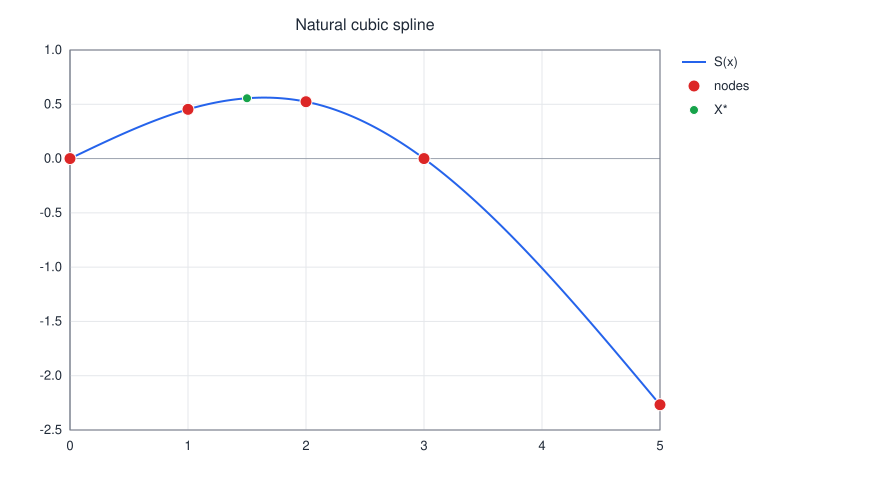

# 3.2. Cubic Spline

Builds a smooth piecewise cubic curve through the table points and evaluates it at a given point.

## Task

Build a cubic spline for the function given at the interpolation nodes, assuming the spline has zero curvature at $x = x_0$ and $x = x_4$. Compute the value of the function at the point $X^*$.

Variant 28:

| $x_i$ | 0.0 | 1.0 | 2.0 | 3.0 | 5.0 |
| --- | --- | --- | --- | --- | --- |
| $f_i$ | 0.0 | 0.45345 | 0.52360 | 0.0 | -2.2672 |

$X^* = 1.5$. Answer: $S(1.5) \approx 0.5556$.

## Method

On every segment $[x_{i-1}, x_i]$ the spline is a cubic polynomial
$$S_i(x) = a_i + b_i(x - x_{i-1}) + c_i(x - x_{i-1})^2 + d_i(x - x_{i-1})^3.$$

- **Conditions.** The spline passes through the nodes, its value, first and second derivatives are continuous at the inner nodes, and $S''(x_0) = S''(x_n) = 0$, so $c_1 = 0$.
- **System for $c_i$.** With $h_i = x_i - x_{i-1}$ the conditions give a tridiagonal system
  $$h_{i-1}c_{i-1} + 2(h_{i-1} + h_i)c_i + h_i c_{i+1} = 3\left(\frac{f_i - f_{i-1}}{h_i} - \frac{f_{i-1} - f_{i-2}}{h_{i-1}}\right),$$
  solved with the Thomas algorithm from lab 1.
- **Other coefficients.** $a_i = f_{i-1}$, $b_i = \frac{f_i - f_{i-1}}{h_i} - \frac{h_i(c_{i+1} + 2c_i)}{3}$, $d_i = \frac{c_{i+1} - c_i}{3h_i}$, with $c_{n+1} = 0$.

The nodes may be unequally spaced; the last segment of the variant is twice as long.

## Run

```bash
make run LAB=lab3 TASK=task2
make run LAB=lab3 TASK=task2 ARGS=my_input.txt
python3 -m lab3.task2.main [file]
```

Commands run from the repository root. Without an argument the program reads `input.txt` next to `main.py`. Every run also saves the graphs next to the input file.

## Input

Numbers separated by spaces or new lines: the number of nodes $n$, the nodes $x_i$, the values $f_i$, the point $X^*$.

```text
5
0.0 1.0 2.0 3.0 5.0
0.0 0.45345 0.52360 0.0 -2.2672
1.5
```

## Output

```text
Spline coefficients:
  i  x_(i-1)     x_i     a_i      b_i      c_i      d_i
  1   0.0000  1.0000  0.0000   0.5216   0.0000  -0.0682
  2   1.0000  2.0000  0.4535   0.3171  -0.2045  -0.0424
  3   2.0000  3.0000  0.5236  -0.2192  -0.3318   0.0273
  4   3.0000  5.0000  0.0000  -0.8007  -0.2497   0.0416

f(X*) = S(1.5000) = 0.5556
```

The coefficients $a_i, b_i, c_i, d_i$ of every segment and the value $S(X^*)$.

## Graphs

`plot.svg`: the spline, the nodes and the point $X^*$.



## Files

| File | Contents |
| --- | --- |
| [main.py](main.py) | the variant: reads the input, prints the result, saves the graphs |
| [spline.py](spline.py) | the natural cubic spline |
| [input.txt](input.txt) | data of the variant |
| [output.txt](output.txt) | expected output, checked by the tests |
| [plot.svg](plot.svg) | graph of the variant, checked by the tests |

Invalid input or a failed method prints `error: <message>` to stderr and exits with code 1.
