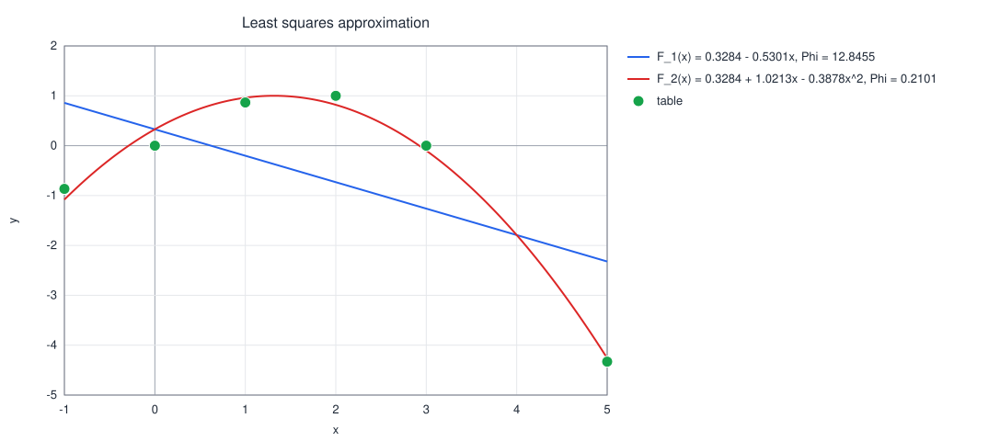

# 3.3. Least Squares

Fits a line and a parabola to the table points so that the sum of squared errors is minimal.

## Task

For the function given by a table, find the approximating polynomials of a) degree 1 and b) degree 2 by solving the normal system of the least squares method. For each polynomial compute the sum of squared errors. Plot the approximated function and the approximating polynomials.

Variant 28:

| $x_i$ | -1.0 | 0.0 | 1.0 | 2.0 | 3.0 | 5.0 |
| --- | --- | --- | --- | --- | --- | --- |
| $y_i$ | -0.86603 | 0.0 | 0.86603 | 1.0 | 0.0 | -4.3301 |

Answer: $F_1(x) = 0.3284 - 0.5301x$, $\Phi_1 = 12.8455$; $F_2(x) = 0.3284 + 1.0213x - 0.3878x^2$, $\Phi_2 = 0.2101$.

## Method

The polynomial $F_n(x) = \sum_{i=0}^n a_i x^i$ minimizes the sum of squared errors $\Phi = \sum_j (F_n(x_j) - y_j)^2$. Setting $\partial\Phi / \partial a_k = 0$ gives the normal system
$$\sum_{i=0}^n a_i \sum_j x_j^{k+i} = \sum_j y_j x_j^k, \qquad k = 0, \ldots, n,$$
which is solved with the LU decomposition from lab 1. Unlike interpolation, the polynomial does not pass through the points; it smooths them.

Both polynomials have the same constant term $0.3284$: on these nodes the least squares line for $x^2$ is exactly $4x$, so adding the $x^2$ term does not change $a_0$.

## Run

```bash
make run LAB=lab3 TASK=task3
make run LAB=lab3 TASK=task3 ARGS=my_input.txt
python3 -m lab3.task3.main [file]
```

Commands run from the repository root. Without an argument the program reads `input.txt` next to `main.py`. Every run also saves the graphs next to the input file.

## Input

Numbers separated by spaces or new lines: the number of points $n$, the values $x_i$, the values $y_i$.

```text
6
-1.0 0.0 1.0 2.0 3.0 5.0
-0.86603 0.0 0.86603 1.0 0.0 -4.3301
```

## Output

```text
Degree 1, normal system:
   6.0000  10.0000  |   -3.3301
  10.0000  40.0000  |  -17.9184
F_1(x) = 0.3284 - 0.5301x
Sum of squared errors: 12.8455

Degree 2, normal system:
    6.0000   10.0000   40.0000  |    -3.3301
   10.0000   40.0000  160.0000  |   -17.9184
   40.0000  160.0000  724.0000  |  -104.2525
F_2(x) = 0.3284 + 1.0213x - 0.3878x^2
Sum of squared errors: 0.2101
```

For degrees 1 and 2: the normal system (the matrix and, after `|`, the right-hand side), the polynomial and the sum of squared errors.

## Graphs

`plot.svg`: the table points and both approximating polynomials with their sums of squared errors.



## Files

| File | Contents |
| --- | --- |
| [main.py](main.py) | the variant: reads the input, prints the result, saves the graphs |
| [least_squares.py](least_squares.py) | the normal system and its solution |
| [input.txt](input.txt) | data of the variant |
| [output.txt](output.txt) | expected output, checked by the tests |
| [plot.svg](plot.svg) | graph of the variant, checked by the tests |

Invalid input or a failed method prints `error: <message>` to stderr and exits with code 1.
