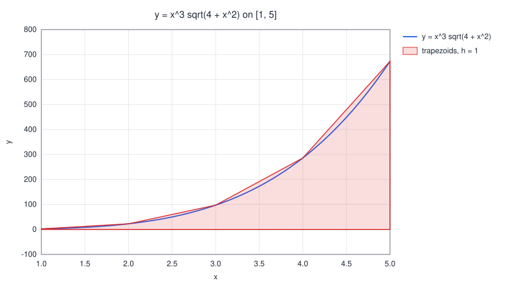

# 3.5. Numerical Integration

Computes a definite integral with three quadrature rules and estimates their errors by the Runge-Romberg method.

## Task

Compute the definite integral $F = \int_{X_0}^{X_k} y\,dx$ by the rectangle, trapezoid and Simpson rules with the steps $h_1$, $h_2$. Estimate the error with the Runge-Romberg method.

Variant 28:

$$
F = \int_1^5 x^3 \sqrt{4 + x^2}\,dx, \qquad h_1 = 1, \qquad h_2 = 0.5
$$

Answer: $F \approx 701.2851$.

## Method

With $n = (X_k - X_0) / h$ steps and $x_i = X_0 + ih$:

- **midpoint rectangles** (order 2): $F \approx h\sum_{i=1}^n y\left(\frac{x_{i-1} + x_i}{2}\right)$;
- **trapezoids** (order 2): $F \approx h\left(\frac{y_0 + y_n}{2} + \sum_{i=1}^{n-1} y_i\right)$;
- **Simpson** (order 4, even $n$): $F \approx \frac{h}{3}(y_0 + 4y_1 + 2y_2 + 4y_3 + \ldots + 4y_{n-1} + y_n)$.

**Runge-Romberg.** With the steps $h_1 = k h_2$ and a method of order $p$, $F \approx F_{h_2} + \frac{F_{h_2} - F_{h_1}}{k^p - 1}$; the correction estimates the error of $F_{h_2}$.

The exact value $F = \left[\frac{u^{5/2}}{5} - \frac{4u^{3/2}}{3}\right]_{u = 5}^{u = 29}$ with $u = 4 + x^2$ shows the real errors next to the estimates. The estimates almost coincide with the real errors, and the refined values are 180 to 320 times more accurate.

## Run

```bash
make run LAB=lab3 TASK=task5
make run LAB=lab3 TASK=task5 ARGS=my_input.txt
python3 -m lab3.task5.main [file]
```

Commands run from the repository root. Without an argument the program reads `input.txt` next to `main.py`. Every run also saves the graphs next to the input file.

## Input

Numbers separated by spaces or new lines: the limits $X_0$, $X_k$ and the steps $h_1$, $h_2$.

```text
1 5
1.0 0.5
```

## Output

```text
Exact value: 701.2851
      method     h = 1   h = 0.5    estimate       error   refined  refined error
  Rectangles  680.0351  695.9508  5.3052e+00  5.3343e+00  701.2560     2.9098e-02
  Trapezoids  743.8848  711.9600  1.0642e+01  1.0675e+01  701.3184     3.3246e-02
     Simpson  701.8193  701.3184  3.3395e-02  3.3246e-02  701.2850     1.4951e-04
```

The exact value, then for every method: the integrals with both steps, the Runge-Romberg estimate, the real error, the refined value and its error.

## Analysis

| method | error, $h = 0.5$ | Runge-Romberg estimate | error after refinement |
| --- | --- | --- | --- |
| rectangles | 5.33 | 5.31 | 0.029 |
| trapezoids | 10.68 | 10.64 | 0.033 |
| Simpson | 0.033 | 0.033 | 0.00015 |

- The function is convex, so the rectangles underestimate the integral and the trapezoids overestimate it about twice as much.
- The Runge-Romberg estimates almost coincide with the real errors.
- Simpson's rule with $h = 0.5$ equals the refined trapezoid value: Simpson's formula is exactly the Runge-Romberg refinement of the trapezoid rule.

## Graphs

`plot.svg`: the integrand and the trapezoids with the step $h_1$: the function is convex, so the trapezoids lie above it and overestimate the integral.



## Files

| File | Contents |
| --- | --- |
| [main.py](main.py) | the variant: reads the input, prints the result, saves the graphs |
| [integration.py](integration.py) | the three rules and the Runge-Romberg method |
| [input.txt](input.txt) | data of the variant |
| [output.txt](output.txt) | expected output, checked by the tests |
| [plot.svg](plot.svg) | graph of the variant, checked by the tests |

Invalid input or a failed method prints `error: <message>` to stderr and exits with code 1.
