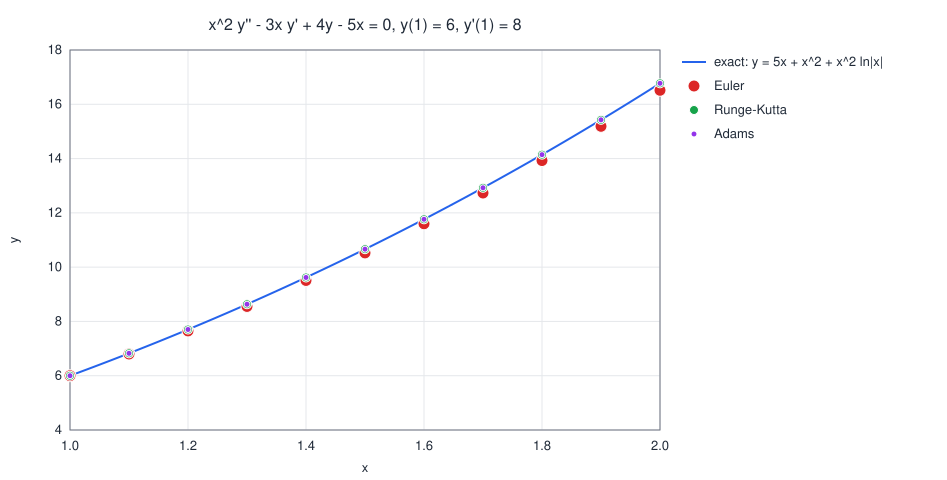
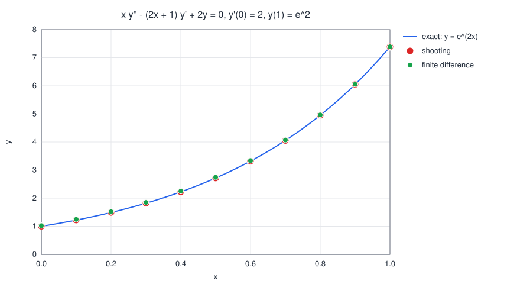

# Lab 4. Numerical Methods for Ordinary Differential Equations

## Task

Variant 28. Every task lives in its own folder:

| No. | Folder | Method | Result |
| --- | --- | --- | --- |
| 4.1 | [task1](task1/) | Euler, Runge-Kutta and Adams methods of order 4 | solution of a Cauchy problem, Runge-Romberg and exact errors |
| 4.2 | [task2](task2/) | shooting and finite difference methods | solution of a boundary value problem, Runge-Romberg and exact errors |

## Build and run

```bash
make run LAB=lab4
make run LAB=lab4 TASK=task1
make run LAB=lab4 TASK=task1 ARGS=my_input.txt
make test LAB=lab4
```

The first command runs both tasks, the second one task on its `input.txt`, the third one task on another file. Without `make`: `python3 -m lab4.main` and `python3 -m lab4.task1.main [file]` from the repository root. Every run also saves the graph `plot.svg` next to the input file.

## Example

4.1, $h = 0.1$:

$$
x^2 y'' - 3x y' + 4y - 5x = 0, \quad y(1) = 6, \quad y'(1) = 8, \quad x \in [1, 2],
\qquad y = 5x + x^2 + x^2 \ln |x|
$$

The statement prints $+3xy'$, but the given exact solution and the initial conditions satisfy the equation only with $-3xy'$, so the program solves this consistent equation. Adams' method takes its first three steps with the Runge-Kutta method.



4.2, $h = 0.1$, $\varepsilon = 10^{-6}$:

$$
x y'' - (2x + 1) y' + 2y = 0, \quad y'(0) = 2, \quad y(1) = e^2,
\qquad y = e^{2x}
$$

The equation is singular at $x = 0$, where the coefficient of $y''$ vanishes. That is why the shooting method starts at the regular end: $y(1) = e^2$, $y'(1) = \eta$. It integrates to $x = 0$ with Adams' method, which never evaluates the right-hand side at the last node, and finds $\eta \approx 2e^2$ from $y'(0) = 2$ by the secant method. The finite difference method approximates the boundary derivatives with second-order one-sided differences and solves the tridiagonal system with the Thomas algorithm from lab 1.



Both tasks estimate the error with the Runge-Romberg method on the steps $h$ and $2h$, $R = \dfrac{|y_h - y_{2h}|}{2^p - 1}$, and compare the solution with the exact one.

## Notes

Input: numbers or expressions without spaces (`pi/6`, `e^2`) separated by spaces or new lines. A boundary condition $\alpha y + \beta y' = \gamma$ is written as $\alpha$, $\beta$, $\gamma$.

| Task | Input |
| --- | --- |
| task1 | segment $a$, $b$, initial values $y(a)$, $y'(a)$, step $h$ |
| task2 | segment $a$, $b$, left condition, right condition, step $h$, shooting precision $\varepsilon$ |

The step must divide the segment into an even number of parts. Invalid input or a failed method prints `error: <message>` to stderr and exits with code 1.

Layout:

```text
lab4/
  README.md
  main.py        runs both tasks
  common.py      Runge-Romberg and exact error estimates
  task1/
    main.py      the variant: reads input.txt (or the given file), prints the result, saves plot.svg
    cauchy.py    the methods
    input.txt    data of the variant
    output.txt   expected output, checked by the tests
    plot.svg     graph of the variant, checked by the tests
  task2/         the same layout, the methods are in boundary.py
  tests/         tests of every method and of all programs
```
