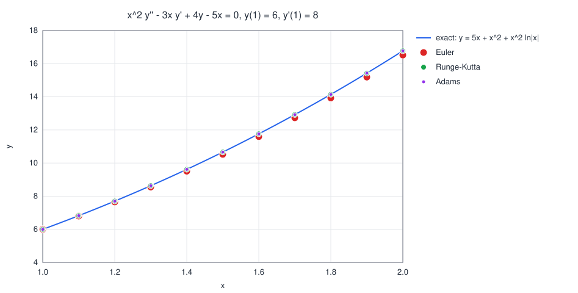
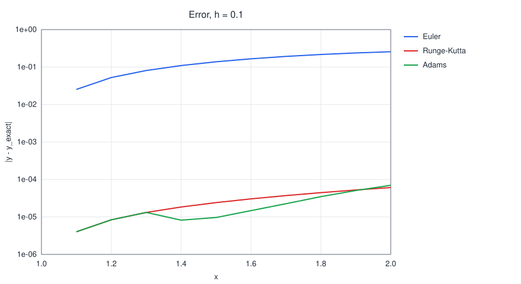

# 4.1. Cauchy Problem

Solves an initial value problem for a second-order equation with methods of order 1 and 4 and estimates their errors.

## Task

Implement the Euler, Runge-Kutta and Adams methods of order 4, taking the grid step $h$ as input. Use them to solve the Cauchy problem for a second-order ordinary differential equation on the given segment. Estimate the error of the numerical solution with the Runge-Romberg method and by comparison with the exact solution.

Variant 28:

$$
x^2 y'' - 3x y' + 4y - 5x = 0, \qquad y(1) = 6, \qquad y'(1) = 8, \qquad x \in [1, 2], \qquad h = 0.1
$$

Exact solution: $y = 5x + x^2 + x^2 \ln|x|$.

The statement prints $+3xy'$, but the exact solution and the initial conditions satisfy the equation only with $-3xy'$: with the plus sign the substitution leaves $18x^2 + 12x^2\ln x + 30x \ne 0$. The program solves the consistent equation.

## Method

The equation becomes a first-order system with $z = y'$:
$$y' = z, \qquad z' = \frac{3xz - 4y + 5x}{x^2}, \qquad y(1) = 6, \quad z(1) = 8.$$

- **Euler** (order 1): $Y_{k+1} = Y_k + hF(x_k, Y_k)$.
- **Runge-Kutta** (order 4): $Y_{k+1} = Y_k + \frac{h}{6}(K_1 + 2K_2 + 2K_3 + K_4)$ with the slopes at the start, twice at the midpoint and at the end of the step.
- **Adams** (order 4): $Y_{k+1} = Y_k + \frac{h}{24}(55F_k - 59F_{k-1} + 37F_{k-2} - 9F_{k-3})$. The first three steps are made by the Runge-Kutta method; after that every step evaluates the right-hand side only once.
- **Errors.** Runge-Romberg compares the solutions with the steps $h$ and $2h$ at the common nodes: $R = \frac{|y_h - y_{2h}|}{2^p - 1}$; the exact error is $\max_i |y_i - y(x_i)|$.

## Run

```bash
make run LAB=lab4 TASK=task1
make run LAB=lab4 TASK=task1 ARGS=my_input.txt
python3 -m lab4.task1.main [file]
```

Commands run from the repository root. Without an argument the program reads `input.txt` next to `main.py`. Every run also saves the graphs next to the input file.

## Input

Numbers separated by spaces or new lines: the segment $a$, $b$, the initial values $y(a)$, $y'(a)$ and the step $h$. The step must divide the segment into an even number of parts.

```text
1 2
6 8
0.1
```

## Output

```text
       x    Euler  Runge-Kutta    Adams    exact
  1.0000   6.0000       6.0000   6.0000   6.0000
  1.1000   6.8000       6.8253   6.8253   6.8253
  1.2000   7.6500       7.7026   7.7026   7.7025
  1.3000   8.5525       8.6334   8.6334   8.6334
  1.4000   9.5097       9.6195   9.6195   9.6195
  1.5000  10.5240      10.6623  10.6623  10.6623
  1.6000  11.5971      11.7632  11.7632  11.7632
  1.7000  12.7312      12.9236  12.9235  12.9235
  1.8000  13.9279      14.1445  14.1445  14.1444
  1.9000  15.1890      15.4271  15.4271  15.4271
  2.0000  16.5162      16.7726  16.7727  16.7726

Errors:
       method  Runge-Romberg  max |y - y_exact|
        Euler     3.0490e-01         2.5640e-01
  Runge-Kutta     5.2671e-05         6.0990e-05
        Adams     3.9405e-05         7.0038e-05
```

A table of $y$ for the three methods and the exact solution, then the Runge-Romberg estimate and the exact maximum error of every method.

## Analysis

| method | Runge-Romberg | exact error |
| --- | --- | --- |
| Euler | $3.0 \cdot 10^{-1}$ | $2.6 \cdot 10^{-1}$ |
| Runge-Kutta | $5.3 \cdot 10^{-5}$ | $6.1 \cdot 10^{-5}$ |
| Adams | $3.9 \cdot 10^{-5}$ | $7.0 \cdot 10^{-5}$ |

- The Euler method has order 1: its error is three to four orders of magnitude larger and grows along the segment.
- The Runge-Kutta and Adams methods have order 4 and give almost the same accuracy; Adams evaluates the right-hand side once per step instead of four times.
- The Runge-Romberg estimates have the same order as the exact errors.

## Graphs

`plot.svg`: the exact solution and the values of the three methods at the grid nodes.



`plot_error.svg`: the error $|y_k - y(x_k)|$ along the segment on a logarithmic scale: the Euler method is three to four orders of magnitude worse.



## Files

| File | Contents |
| --- | --- |
| [main.py](main.py) | the variant: reads the input, prints the result, saves the graphs |
| [cauchy.py](cauchy.py) | the Euler, Runge-Kutta and Adams methods for first-order systems |
| [input.txt](input.txt) | data of the variant |
| [output.txt](output.txt) | expected output, checked by the tests |
| [plot.svg](plot.svg) | graph of the variant, checked by the tests |
| [plot_error.svg](plot_error.svg) | graph of the variant, checked by the tests |

Invalid input or a failed method prints `error: <message>` to stderr and exits with code 1.
