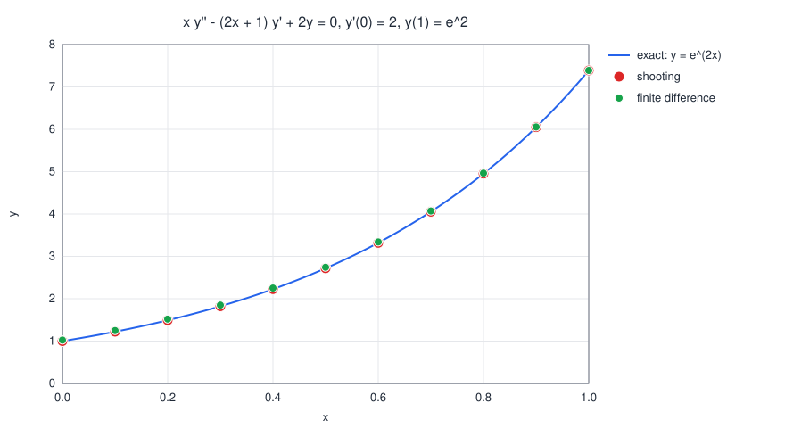
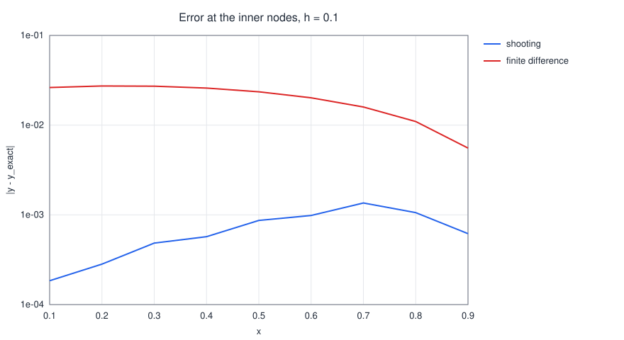

# 4.2. Boundary Value Problem

Solves a boundary value problem with a singular point by the shooting and finite difference methods and estimates their errors.

## Task

Implement the shooting method and the finite difference method for a boundary value problem for an ordinary differential equation. Use them to solve the boundary value problem for a second-order ordinary differential equation on the given segment. Estimate the error of the numerical solution with the Runge-Romberg method and by comparison with the exact solution.

Variant 28:

$$
x y'' - (2x + 1) y' + 2y = 0, \qquad y'(0) = 2, \qquad y(1) = e^2, \qquad h = 0.1
$$

Exact solution: $y = e^{2x}$.

## Method

The equation is written as $y'' + p(x)y' + q(x)y = f(x)$ with $p = -\frac{2x + 1}{x}$, $q = \frac{2}{x}$, $f = 0$. A boundary condition $\alpha y + \beta y' = \gamma$ is given by $\alpha$, $\beta$, $\gamma$.

The point $x = 0$ is singular: the coefficient of $y''$ vanishes there and $p$, $q$ are unbounded. Every solution $C_1 e^{2x} + C_2(2x + 1)$ satisfies $y'(0) = 2y(0)$.

- **Shooting.** The missing condition at the regular end is guessed: $y(1) = e^2$, $y'(1) = \eta$. The Cauchy problem is solved from $x = 1$ to $x = 0$ by the Adams method of lab 4.1, which never evaluates the right-hand side at the last node $x = 0$. The residual $\Phi(\eta) = y'(0) - 2$ is driven to zero by the secant method, starting from $\eta = 0$ and $\eta = 1$. The equation is linear, so $\Phi$ is linear and one secant step finds $\eta = 14.7855$ (exactly $2e^2 = 14.7781$).
- **Finite differences.** $y'' \approx \frac{y_{i+1} - 2y_i + y_{i-1}}{h^2}$, $y' \approx \frac{y_{i+1} - y_{i-1}}{2h}$ at the inner nodes; the boundary derivatives use the second-order one-sided differences $\frac{-3y_0 + 4y_1 - y_2}{2h}$ and $\frac{3y_n - 4y_{n-1} + y_{n-2}}{2h}$. The extra coefficient is eliminated with the neighbouring equation, so the system stays tridiagonal and is solved with the Thomas algorithm from lab 1. The singular node $x = 0$ only enters through the boundary condition.
- **Errors.** Runge-Romberg with the steps $h$ and $2h$ ($p = 4$ for shooting, $p = 2$ for finite differences) and the exact maximum error.

## Run

```bash
make run LAB=lab4 TASK=task2
make run LAB=lab4 TASK=task2 ARGS=my_input.txt
python3 -m lab4.task2.main [file]
```

Commands run from the repository root. Without an argument the program reads `input.txt` next to `main.py`. Every run also saves the graphs next to the input file.

## Input

Numbers separated by spaces or new lines: the segment $a$, $b$, the left condition $\alpha$, $\beta$, $\gamma$, the right condition $\alpha$, $\beta$, $\gamma$, the step $h$ and the precision $\varepsilon$ of the shooting method. Numbers may be written as expressions: `e^2`.

```text
0 1
0 1 2
1 0 e^2
0.1
0.000001
```

## Output

```text
Shooting method, secant iterations:
  k      eta     residual
  0   0.0000   4.3880e+00
  1   1.0000   4.0912e+00
  2  14.7855  -1.1102e-15

       x  shooting  finite difference   exact
  0.0000    1.0000             1.0238  1.0000
  0.1000    1.2212             1.2477  1.2214
  0.2000    1.4915             1.5191  1.4918
  0.3000    1.8216             1.8493  1.8221
  0.4000    2.2250             2.2514  2.2255
  0.5000    2.7174             2.7418  2.7183
  0.6000    3.3191             3.3403  3.3201
  0.7000    4.0538             4.0711  4.0552
  0.8000    4.9520             4.9640  4.9530
  0.9000    6.0490             6.0552  6.0496
  1.0000    7.3891             7.3891  7.3891

Errors:
             method  Runge-Romberg  max |y - y_exact|
           shooting     8.9844e-04         1.3563e-03
  finite difference     3.3670e-02         2.7323e-02
```

The secant iterations of the shooting method, a table of both solutions and the exact one, then the Runge-Romberg estimate and the exact maximum error of every method.

## Analysis

| method | Runge-Romberg | exact error |
| --- | --- | --- |
| shooting | $9.0 \cdot 10^{-4}$ | $1.4 \cdot 10^{-3}$ |
| finite differences | $3.4 \cdot 10^{-2}$ | $2.7 \cdot 10^{-2}$ |

- Shooting is about 20 times more accurate: it relies on the Adams method of order 4, the finite difference scheme has order 2.
- The largest finite difference errors are near the singular end $x = 0$, where the coefficients $p$ and $q$ are large.
- The secant method needs one step, because for a linear equation the residual $\Phi(\eta)$ is linear.

## Graphs

`plot.svg`: the exact solution and both numerical solutions at the grid nodes.



`plot_error.svg`: the error at the inner nodes on a logarithmic scale: shooting is about 20 times more accurate.



## Files

| File | Contents |
| --- | --- |
| [main.py](main.py) | the variant: reads the input, prints the result, saves the graphs |
| [boundary.py](boundary.py) | the shooting method and the finite difference method |
| [input.txt](input.txt) | data of the variant |
| [output.txt](output.txt) | expected output, checked by the tests |
| [plot.svg](plot.svg) | graph of the variant, checked by the tests |
| [plot_error.svg](plot_error.svg) | graph of the variant, checked by the tests |

Invalid input or a failed method prints `error: <message>` to stderr and exits with code 1.
